# Screenshot gallery

[Back to the README](../README.md) · [Installation](installation.md)

## Personal appearance

The v0.2 customizer provides a live preview of neutral palettes, accents, corners, density, card
treatment, navigation, workspace layout and contrast. Signed-in users save their own preferences;
developers choose the defaults, access policy and available controls. See the [setup guide](customization.md).

| Light | Dark |
| --- | --- |
| 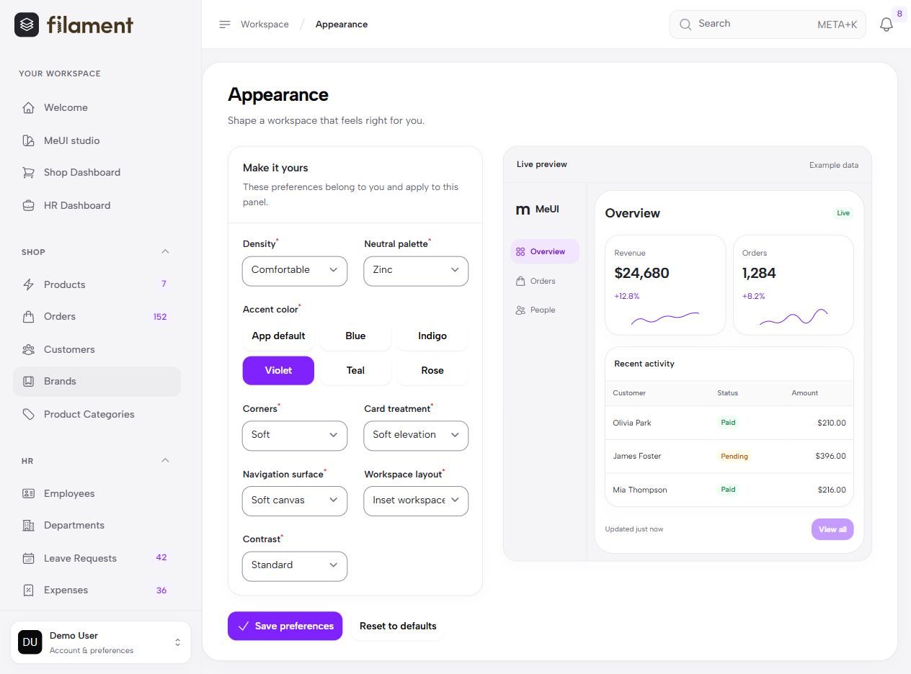 | 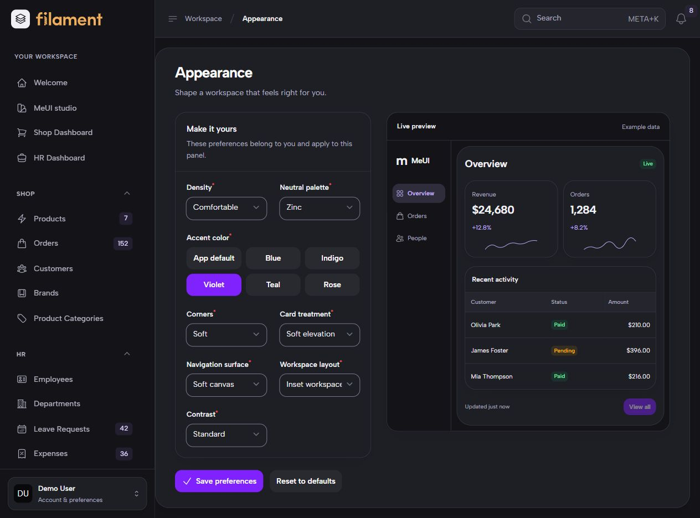 |

The page stacks its form and preview on narrow screens. [View the mobile capture](images/customizer-mobile.jpg).

## Native authentication

Real Filament authentication pages with MeUI's split layout. These captures show empty forms; no
account creation or recovery email was submitted. Logos follow the host panel's native branding.

| Sign in — light | Sign in — dark |
| --- | --- |
| 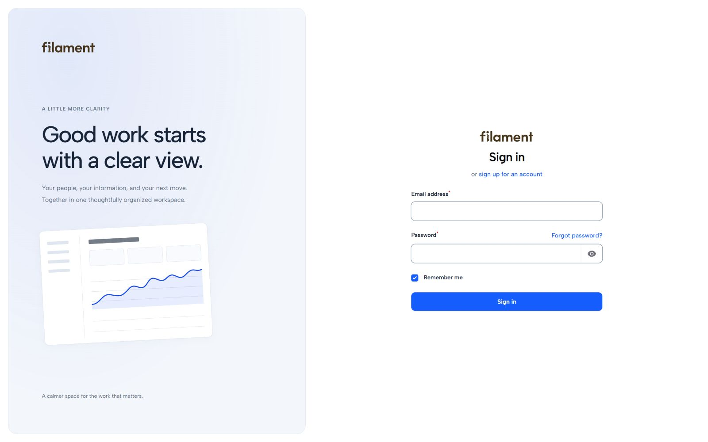 | 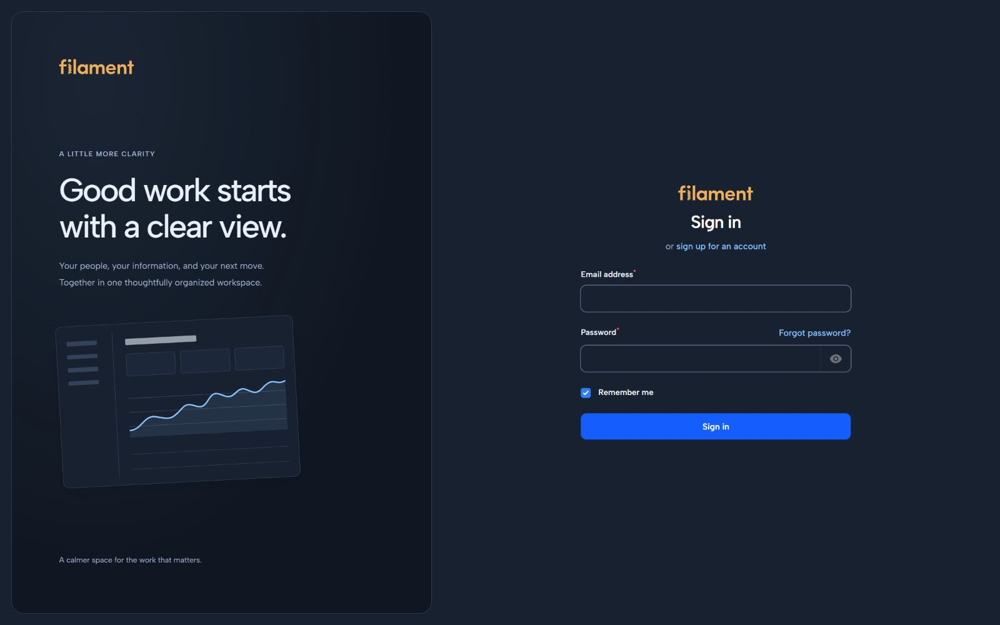 |

| Registration | Account recovery |
| --- | --- |
| 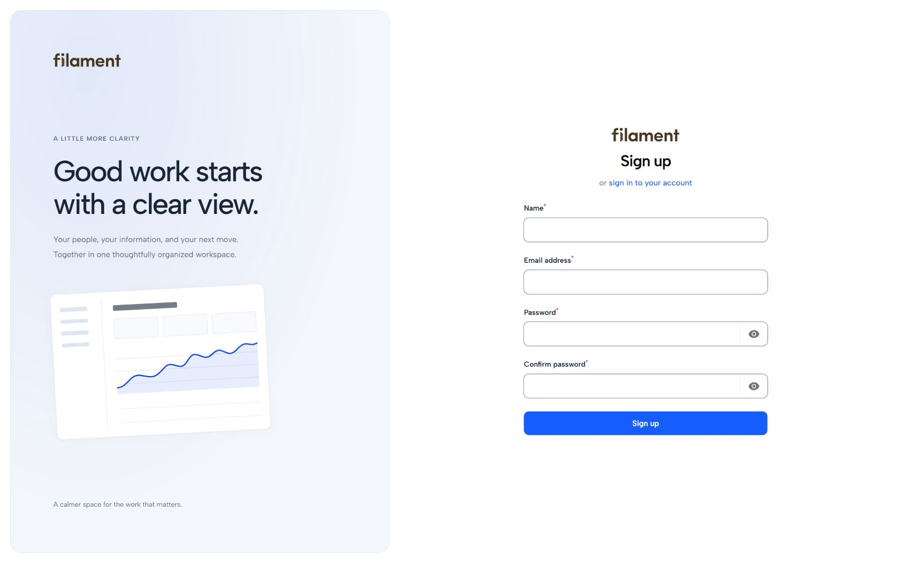 | 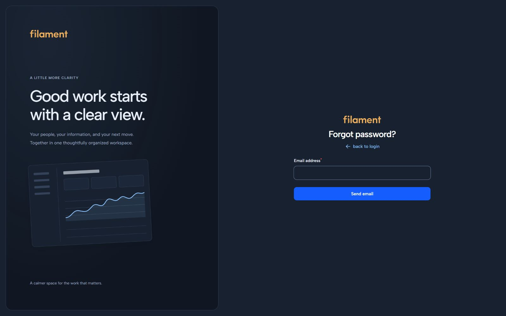 |

## MeUI Studio

A working reference for the package's native components and semantic notices. Studio examples are
fictitious and do not query application business records. Enable it for an authorized audience as
described in [components](components.md).

| Data workspace | Native forms |
| --- | --- |
| 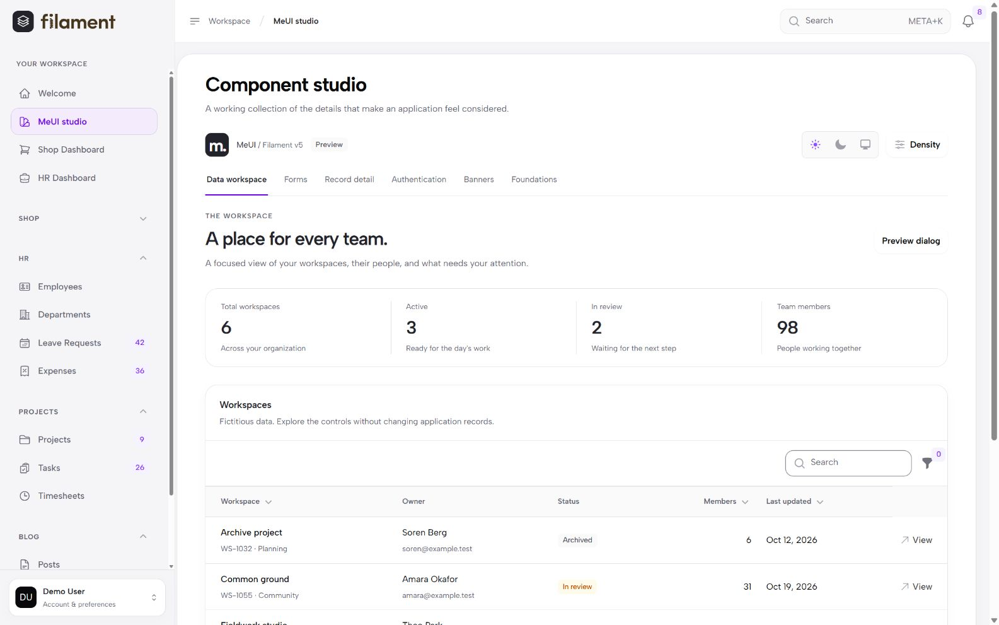 | 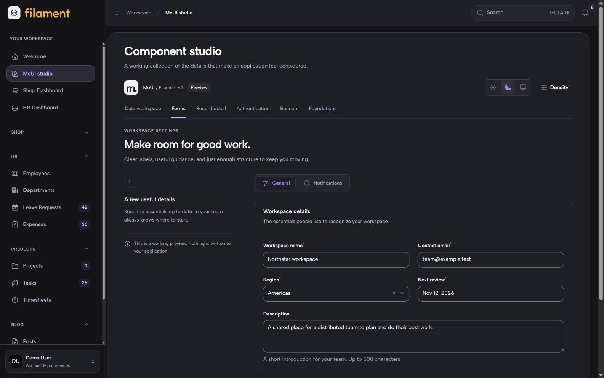 |

| Notice components | Focused dialogs |
| --- | --- |
| 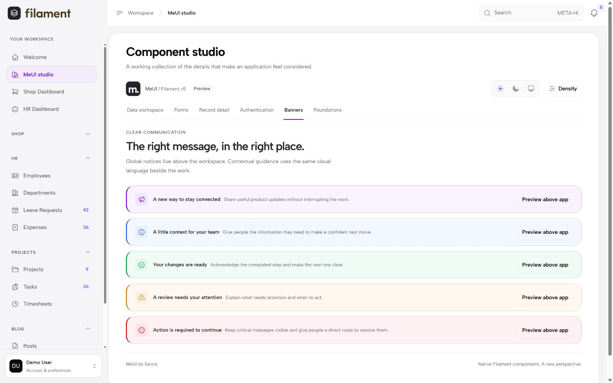 | 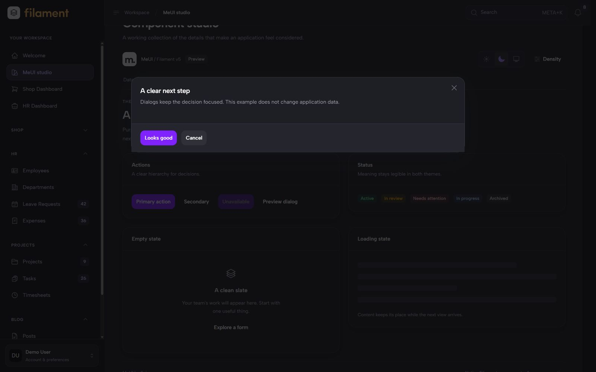 |

[View the light form capture](images/studio-form-light.jpg).

## Application components

Native order creation, form sections, rich text, media uploads, pricing and product associations.

| Order wizard | Product editing |
| --- | --- |
| 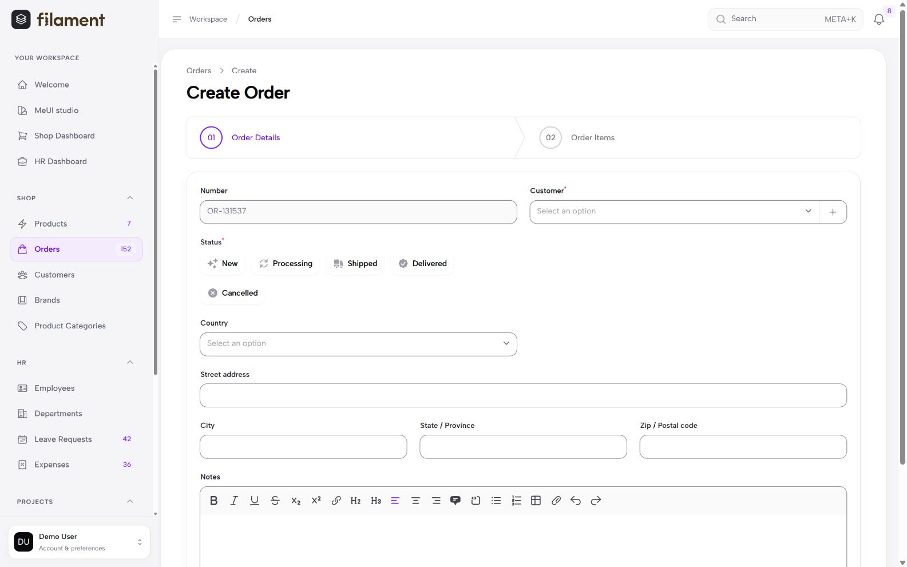 | 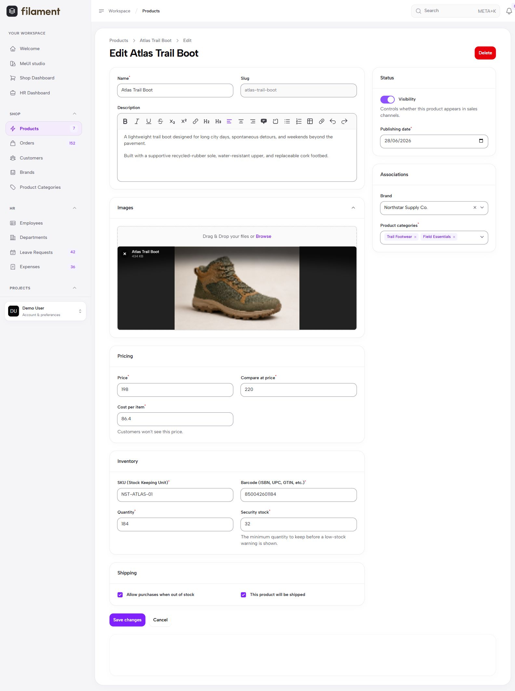 |

All application captures use a local copy of the [official Filament demo](https://github.com/filamentphp/demo),
branch `5.x`, source revision
[`c7fcf1e`](https://github.com/filamentphp/demo/commit/c7fcf1e352f83b0a27743d3667b7a82a2cdd27d6),
running Filament 5.10.3. All people, addresses, orders and financial figures are demonstration data.
The authentication, customizer, studio, wizard and product images show v0.2. The dashboard comparisons and
people/project captures below document the initial release.

## Marketing previews

These illustrated visuals explore a polished direction for MeUI in light and dark mode. They refine
the presentation beyond the current application captures, including an ApexCharts-style analytical
composition. The theme uses your application's chart components; a chart library or new dashboard
is not bundled with MeUI.

### Orders in light mode

A refined marketing preview of the demo's order-management screen, with readable navigation,
statistics, status tabs and a balanced landscape table.

## Initial release comparisons

The following images are unretouched captures of a local copy of the
[official Filament demo](https://github.com/filamentphp/demo), branch `5.x`, source revision
[`c7fcf1e`](https://github.com/filamentphp/demo/commit/c7fcf1e352f83b0a27743d3667b7a82a2cdd27d6).
The copy runs Filament 5.10.3 with MeUI and uses the demo's standard and marketing-preview seeders.
All people, addresses, orders and financial figures are demonstration data.

### Shop dashboard

| Original demo | MeUI |
| --- | --- |
|  |  |
|  |  |

### People

Employee statistics, page tabs, filters, employment badges and a dense operational table.

### Projects

Project status, priority, budgets, progress, date columns and row actions.

## Artwork files

| Use | File | Dimensions |
| --- | --- | --- |
| Main plugin image | [JPEG](https://raw.githubusercontent.com/saivra/meui-theme/main/docs/images/meui-listing.jpg) | 2560×1440, 16:9 |
| Directory thumbnail | [JPEG](https://raw.githubusercontent.com/saivra/meui-theme/main/docs/images/meui-thumbnail.jpg) | 1280×720, 16:9 |
| Light comparison | [JPEG](https://raw.githubusercontent.com/saivra/meui-theme/main/docs/images/comparison-light.jpg) | 2560×1440, 16:9 |
| Dark comparison | [JPEG](https://raw.githubusercontent.com/saivra/meui-theme/main/docs/images/comparison-dark.jpg) | 2560×1440, 16:9 |

The main image and thumbnail are distinct compositions, with light UI in the foreground. Filament and
the demo assets remain the work of their respective owners. See [third-party notices](../THIRD_PARTY_NOTICES.md).
